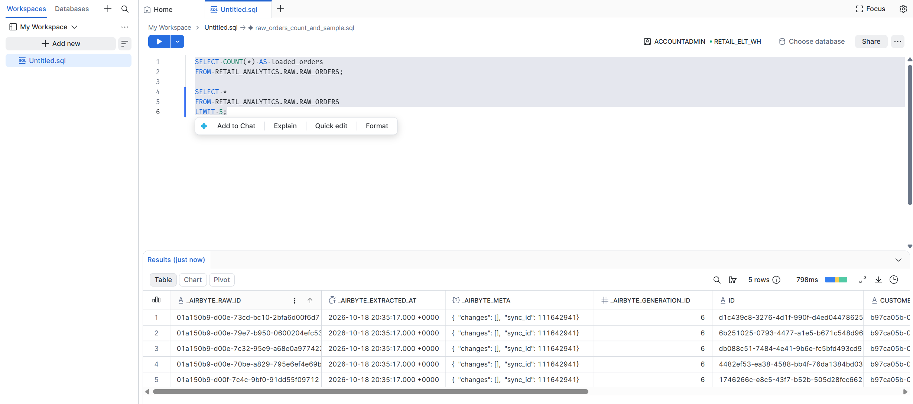
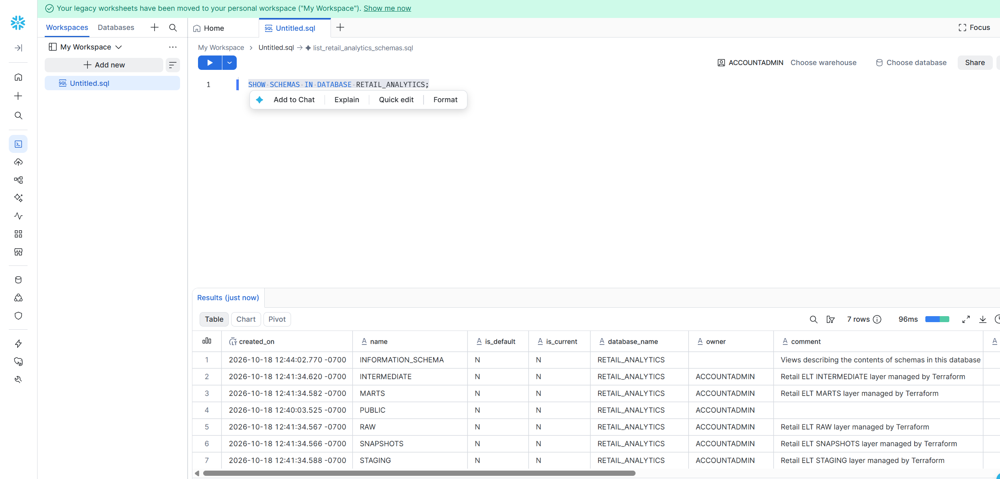
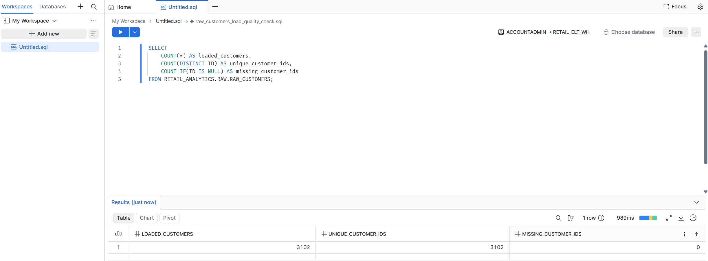
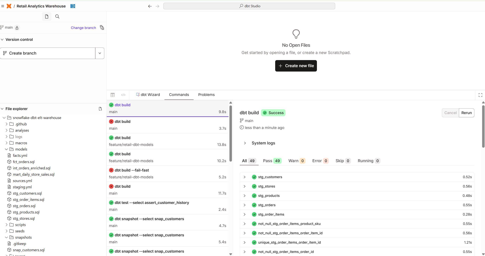
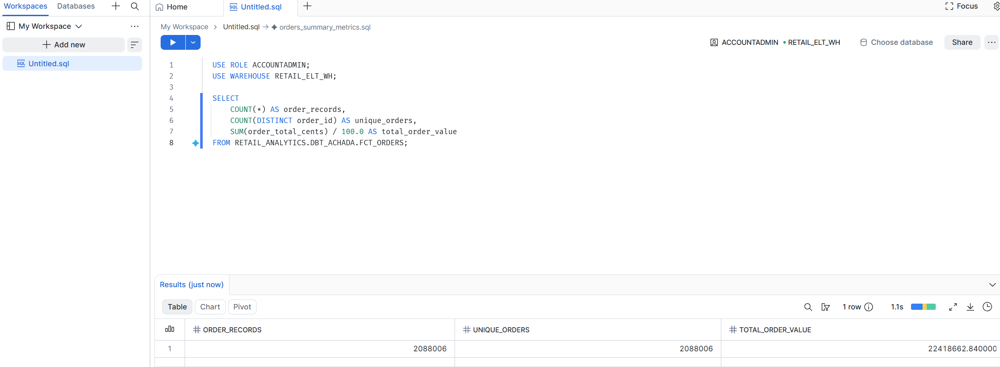
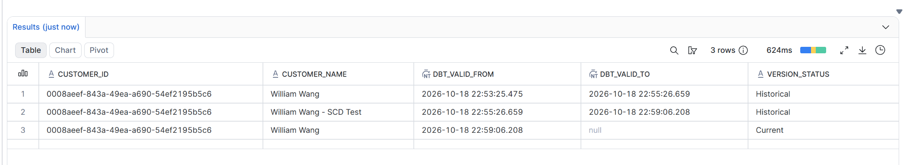
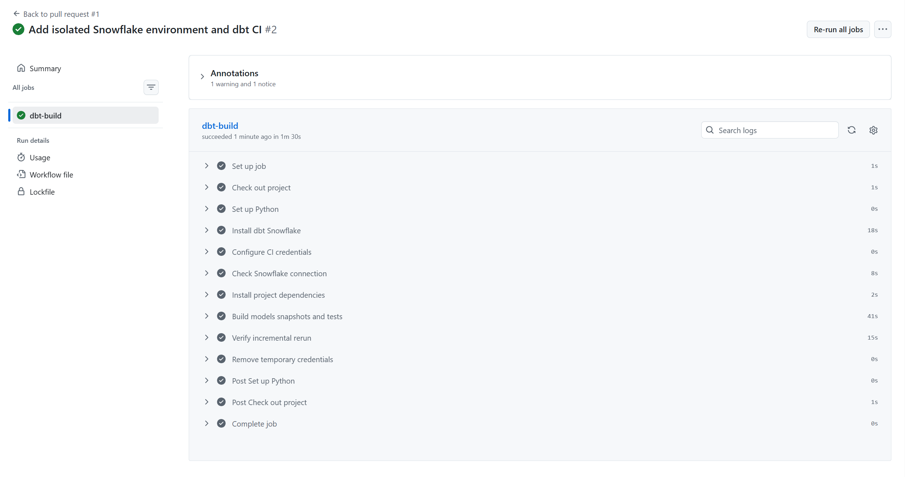

# Snowflake Retail Analytics ELT Warehouse

A retail analytics project built with **Snowflake, dbt Cloud, Airbyte, Terraform, and GitHub Actions**.

The project loads five public datasets into Snowflake, transforms them into tested analytical models, maintains customer history, and validates pull request changes in an isolated CI environment.

## Business Problem

Retail reporting combines information from orders, order items, customers, products, and stores. Without consistent modeling and validation:

- Joining orders directly to multiple items can duplicate order totals.
- Reloading analytical tables can rewrite unchanged records.
- Overwriting customer details removes previous versions.
- Untested changes can introduce incorrect reporting results.
- Manually configured infrastructure can be difficult to reproduce.

This project addresses these problems through controlled ingestion, reusable SQL transformations, incremental merges, customer history snapshots, automated tests, and infrastructure as code.

## Technology Stack

| Tool | Purpose |
|---|---|
| Airbyte | Loads public CSV datasets into Snowflake |
| Snowflake | Stores raw data and analytical models |
| dbt Cloud | Develops and executes SQL models, tests, and snapshots |
| Terraform | Provisions Snowflake infrastructure and permissions |
| GitHub Actions | Validates dbt changes on pull requests |
| Python | Generates encrypted authentication key pairs |
| Git and GitHub | Version control, reviews, and documentation |

## Architecture

Airbyte loads five HTTPS CSV sources into the Snowflake RAW schema.

dbt transforms the raw tables through:

1. **Staging:** Standardized identifiers, dates, names, and monetary values.
2. **Intermediate:** Order-level enrichment with aggregated item information.
3. **Fact and mart models:** Incremental orders and daily store sales reporting.
4. **Snapshots:** Customer name history using SCD Type 2.

Terraform manages infrastructure and access. GitHub Actions builds and tests proposed dbt changes in a separate CI database.

### Environment Layout

| Environment | Database | Schema |
|---|---|---|
| Raw ingestion | `RETAIL_ANALYTICS` | `RAW` |
| Development models | `RETAIL_ANALYTICS` | `DBT_ACHADA` |
| Pull request CI | `RETAIL_ANALYTICS_CI` | Pull request-specific schema |

Terraform also provisions layer schemas for future deployment separation. Current development models share the personal development schema.

## Dataset

The project uses dbt Labs’ public, synthetic Jaffle Shop dataset.

| Dataset | Loaded Records |
|---|---:|
| Orders | 2,088,006 |
| Order items | 3,024,215 |
| Customers | 3,102 |
| Products | 10 |
| Stores | 6 |
| **Total** | **5,115,339** |

All records are synthetic. This project does not contain production company data.

### Public Source URLs

Use the complete file URLs below when configuring Airbyte:

| Dataset | CSV URL |
|---|---|
| Orders | [raw_orders.csv](https://dbt-tutorial-public.s3.us-west-2.amazonaws.com/long_term_dataset/raw_orders.csv) |
| Order items | [raw_items.csv](https://dbt-tutorial-public.s3.us-west-2.amazonaws.com/long_term_dataset/raw_items.csv) |
| Customers | [raw_customers.csv](https://dbt-tutorial-public.s3.us-west-2.amazonaws.com/long_term_dataset/raw_customers.csv) |
| Products | [raw_products.csv](https://dbt-tutorial-public.s3.us-west-2.amazonaws.com/long_term_dataset/raw_products.csv) |
| Stores | [raw_stores.csv](https://dbt-tutorial-public.s3.us-west-2.amazonaws.com/long_term_dataset/raw_stores.csv) |

The parent S3 path is a folder prefix, not a browsable directory. Use an individual CSV URL rather than opening the parent path.

## Data Models

| Model | Materialization | Purpose |
|---|---|---|
| `stg_customers` | View | Standardizes customer identifiers and names |
| `stg_products` | View | Standardizes products and converts prices from cents |
| `stg_stores` | View | Standardizes store details and tax rates |
| `stg_orders` | View | Standardizes order keys, timestamps, dates, and amounts |
| `stg_order_items` | View | Standardizes order-item relationships |
| `int_orders_enriched` | View | Adds item counts and catalog totals at order grain |
| `fct_orders` | Incremental | Maintains one record per order |
| `mart_daily_store_sales` | Table | Summarizes daily sales and order activity by store |
| `snap_customers` | Snapshot | Preserves customer name changes |

### Preventing Duplicated Sales Totals

Order items are aggregated to one row per order before joining to orders.

This preserves the order grain and prevents order-level monetary amounts from being multiplied by the number of items.

### Monetary Values

Source monetary values are stored in cents.

Models retain integer-cent values for reconciliation and provide dollar values for reporting.

## Incremental Order Processing

The `fct_orders` model uses:

- `order_id` as its unique key.
- A record hash to detect new or changed records.
- A Snowflake merge to insert or update qualifying records.
- `warehouse_updated_at` to record when a fact row was written.

Unchanged records are excluded from the merge input.

Because the model compares source records with existing fact records, it can detect changes to older orders without relying on the order date as a watermark.

### Verified Behavior

- An unchanged rerun preserved the observed fact counts, totals, and write timestamps.
- A controlled source update increased one order’s subtotal and total by 100 cents.
- The incremental run updated that existing order.
- The source change was restored and the model rerun.

### Processing Boundary

This strategy scans the source model to identify changes. It reduces unnecessary target writes but does not implement incremental source extraction.

Source deletions are not currently propagated to the order fact table.

## Customer History: SCD Type 2

The `snap_customers` snapshot uses:

- `customer_id` as the unique key.
- A check strategy on `customer_name`.
- `dbt_valid_from` and `dbt_valid_to` to represent version validity.

When a customer name changes, dbt closes the previous version and creates a new current version.

### Verified Example

A controlled test produced three versions for one customer:

| Customer Name | Version |
|---|---|
| William Wang | Historical |
| William Wang - SCD Test | Historical |
| William Wang | Current |

The current version has a null `dbt_valid_to`.

Snapshot history begins when changes are captured by the project. It does not reconstruct changes from before the first snapshot.

## Data Quality and Reconciliation

The project includes **40 data tests** covering:

- Unique identifiers.
- Required, non-null fields.
- Referential relationships.
- Order count and monetary reconciliation.
- Daily store sales consistency.
- Exactly one current customer version.
- Valid and non-overlapping customer history intervals.

### Verified dbt Build

The build on `main` completed successfully:

| Resource | Count |
|---|---:|
| Models | 8 |
| Data tests | 40 |
| Snapshot | 1 |
| **Successful Build Tasks** | **49** |
| Warnings | 0 |
| Errors | 0 |
| Skipped Tasks | 0 |

One observed development build completed in **9.8 seconds**. This is an individual run measurement, not a performance benchmark.

### Order Fact Validation

The demonstrated order fact contained:

| Metric | Value |
|---|---:|
| Order records | 2,088,006 |
| Unique order IDs | 2,088,006 |
| Total order value, including tax | $22,418,662.84 |

These amounts represent synthetic dataset values, not business revenue generated by the project.

## Infrastructure as Code

Terraform provisions:

- An X-Small Snowflake warehouse.
- A retail database.
- RAW and analytical layer schemas.
- Loader, transformer, and analyst roles.
- Airbyte and dbt service users.
- Warehouse, database, schema, and table grants.
- A dedicated CI database, role, and user.

### Compute Configuration

The project warehouse uses:

- X-Small compute.
- Automatic suspension after 60 seconds of inactivity.
- Automatic resume.
- A 300-second statement timeout.

### Authentication

Service integrations use RSA key-pair authentication.

Python scripts generate encrypted private keys and corresponding public keys.

Private keys, passphrases, Terraform state, and local environment files are excluded from Git. The Terraform provider lock file is committed.

## Pull Request CI

GitHub Actions runs on pull requests targeting `main` and supports manual execution.

The workflow:

1. Checks out the repository.
2. Sets up Python.
3. Installs dbt Snowflake.
4. Creates temporary authentication and profile files.
5. Checks the Snowflake connection.
6. Installs dbt dependencies.
7. Runs `dbt build`.
8. Reruns the incremental order model and its selected tests.
9. Removes temporary credential files.

### CI Isolation

CI uses:

- A dedicated service user.
- A dedicated CI role.
- Read access to the shared RAW tables.
- A separate database for model builds.
- A schema associated with the pull request.

The workflow uses Node.js 24-compatible actions and an Ubuntu 24.04 runner.

The CI pull request passed and was merged into `main`.

The CI workflow validates dbt resources; it does not currently run Terraform plan or apply.

## Repository Structure

| Path | Contents |
|---|---|
| `models/` | Sources, staging models, intermediate model, facts, mart, and model tests |
| `snapshots/` | Customer history snapshot |
| `tests/` | SQL reconciliation and history tests |
| `terraform/` | Snowflake infrastructure and permissions |
| `scripts/` | Authentication key generation scripts |
| `.github/workflows/` | Pull request CI workflow |
| `screenshots/` | Project validation evidence |
| `dbt_project.yml` | dbt project configuration |

## Setup and Execution

### 1. Prepare the Local Environment

Install:

- Git.
- Python.
- Terraform.
- VS Code or another editor.

Create Snowflake, Airbyte, and dbt Cloud accounts.

Clone the repository:

```powershell
git clone https://github.com/anishachada667-rgb/snowflake-dbt-elt-warehouse.git

Set-Location snowflake-dbt-elt-warehouse

python -m venv .venv

.\.venv\Scripts\python.exe -m pip install cryptography
```

### 2. Generate Authentication Keys

Review and run the appropriate key generation scripts in `scripts/`.

The project uses separate keys for:

- Terraform administration.
- Airbyte ingestion.
- dbt development.
- dbt CI.

Keep private keys and passphrases outside version control.

Register the Terraform administrator public key with the intended Snowflake user before provisioning.

### 3. Review Terraform Configuration

Update the Snowflake account identifiers and administrator login in the Terraform provider configuration.

Review:

- Private-key file paths.
- Public-key file references.
- Resource names.
- Roles and grants.

Run from the repository root:

```powershell
terraform -chdir=terraform init

terraform -chdir=terraform plan

terraform -chdir=terraform apply
```

Enter the encrypted Terraform private-key passphrase when prompted.

Review the plan before applying it to your account.

### 4. Configure Airbyte

Create a Snowflake destination using the loader service user and its authentication key.

Create five HTTPS public-web CSV sources using the individual URLs in the Dataset section.

Configure the destination mappings:

| Source File | Snowflake Target |
|---|---|
| `raw_orders.csv` | `RETAIL_ANALYTICS.RAW.RAW_ORDERS` |
| `raw_items.csv` | `RETAIL_ANALYTICS.RAW.RAW_ORDER_ITEMS` |
| `raw_customers.csv` | `RETAIL_ANALYTICS.RAW.RAW_CUSTOMERS` |
| `raw_products.csv` | `RETAIL_ANALYTICS.RAW.RAW_PRODUCTS` |
| `raw_stores.csv` | `RETAIL_ANALYTICS.RAW.RAW_STORES` |

The demonstration uses manual full-refresh overwrite connections.

Run each sync and validate the loaded tables.

### 5. Configure dbt Cloud

Connect this GitHub repository to dbt Cloud.

Configure the Snowflake development connection with:

- The retail database.
- The project warehouse.
- The transformer role.
- The development service user.
- The encrypted development private key and passphrase.
- A personal development schema.

Update source database references if using different database names.

Run in the dbt Cloud command bar:

```text
dbt deps
```

Then run:

```text
dbt build
```

### 6. Configure GitHub Actions Secrets

Add the following repository Actions secrets:

| Secret | Value |
|---|---|
| `SNOWFLAKE_CI_PRIVATE_KEY` | Complete encrypted CI private key in PEM format |
| `SNOWFLAKE_CI_KEY_PASSPHRASE` | Passphrase for the CI private key |

Review account, user, role, database, and warehouse settings in `.github/workflows/dbt-ci.yml`.

Create a feature branch and open a pull request targeting `main` to trigger CI.

### 7. Validate the Order Fact

For the demonstrated development schema:

```sql
SELECT
    COUNT(*) AS order_records,
    COUNT(DISTINCT order_id) AS unique_orders,
    SUM(order_total_cents) / 100.0 AS total_order_value
FROM RETAIL_ANALYTICS.DBT_ACHADA.FCT_ORDERS;
```

Use your own development schema if it differs.

### 8. Inspect Customer History

```sql
SELECT
    customer_id,
    customer_name,
    dbt_valid_from,
    dbt_valid_to,
    CASE
        WHEN dbt_valid_to IS NULL THEN 'Current'
        ELSE 'Historical'
    END AS version_status
FROM RETAIL_ANALYTICS.DBT_ACHADA.SNAP_CUSTOMERS
WHERE customer_id = '0008aeef-843a-49ea-a690-54ef2195b5c6'
ORDER BY dbt_valid_from;
```

Multiple versions appear only after the snapshot captures changes to that customer.

## Project Evidence

### Airbyte Orders Sync

Successful ingestion of the orders CSV into Snowflake.



### Snowflake Infrastructure

Snowflake database and schema setup supporting the project.



### Customer Validation

Validation of the loaded customer dataset.



### Successful dbt Build

Build on `main` with 49 successful tasks and no warnings or errors.



### Order Fact Validation

Order counts, unique identifiers, and total order value.



### Customer History

Historical and current versions from the controlled customer name change.



### GitHub Actions CI

Successful pull request validation in an isolated Snowflake environment.



## Design Decisions

### Why ELT?

Snowflake handles the SQL transformations after ingestion. Raw tables remain available for inspection, and transformation logic is maintained in version control through dbt.

### Why Airbyte?

Airbyte provides configurable ingestion so the project can focus on warehouse modeling, quality checks, and deployment validation.

### Why Incremental Merges?

Merges allow new and changed orders to be written without rebuilding the entire fact table. Hash comparison supports the static source dataset, which does not provide a reliable update timestamp.

### Why Snapshots?

Customer details can change. Snapshots preserve observed previous values instead of overwriting all history.

### Why Terraform?

Infrastructure definitions make the Snowflake setup reviewable and reproducible.

### Why Isolated CI?

Pull request models are built separately from development models, allowing proposed transformations to be tested before merging.

## Limitations

- The source consists of static public CSV files.
- Airbyte ingestion uses full refresh rather than CDC.
- Incremental processing occurs in the dbt order fact model.
- Hash-based change detection still scans the source model.
- Source deletions are not propagated to the order fact table.
- Snapshot hard-delete handling is not implemented.
- Customer history starts with the first captured snapshot.
- Catalog prices are not a historical transaction-price ledger.
- Development models currently share a personal schema.
- CI schemas remain after runs.
- No scheduled deployment job or business dashboard is included.

## Future Improvements

- Separate development and deployment schemas.
- Add a scheduled deployment workflow.
- Automate cleanup of CI schemas.
- Pin the dbt dependency version used by CI.
- Add source freshness monitoring.
- Add Terraform validation to pull request CI.
- Extend controlled tests to cover inserts and deletions.
- Add business dashboards for store performance and customer activity.

## Cost Management

The X-Small warehouse automatically suspends after 60 seconds of inactivity. Queries and CI runs can resume it.

To manage project costs:

- Keep Airbyte connections manual when scheduled ingestion is unnecessary.
- Review Snowflake credit usage.
- Review Airbyte and dbt Cloud trial or subscription limits.
- Disable unnecessary scheduled jobs.
- Suspend compute when finished.

Infrastructure removal should be planned separately after preserving project evidence and reviewing the Terraform destroy plan.

## Author

**Anisha Reddy Chada**

[GitHub](https://github.com/anishachada667-rgb)